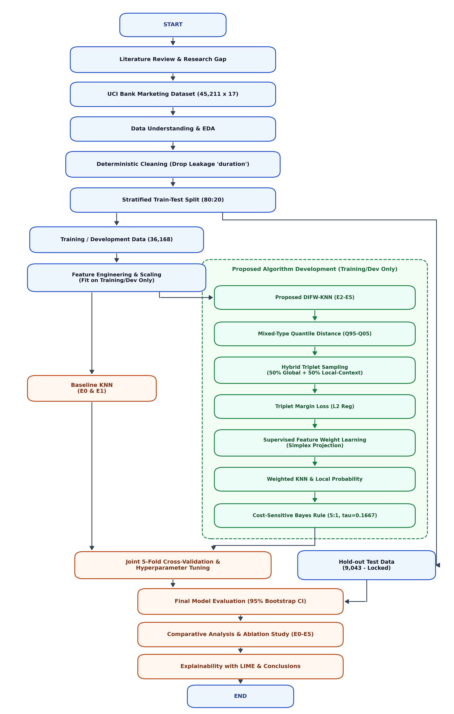

# Distance-Improved and Feature-Weighted K-Nearest Neighbors (DIFW-KNN) untuk Prediksi Langganan Deposito Berjangka pada Data Campuran Tidak Seimbang

**Abstrak** — Prediksi keberhasilan telemarketing deposito berjangka pada dataset *UCI Bank Marketing* (`bank-full.csv`, $N = 45.211$) menghadapi tiga tantangan utama: ketimpangan kelas (*class imbalance* dengan rasio $7{,}55 : 1$, hanya $11{,}70\%$ kelas positif), tipe fitur campuran numerik–kategorikal dengan nilai sentinel (`pdays = -1` pada $81{,}74\%$ observasi), serta risiko *target leakage* dari fitur durasi panggilan (`duration`, `ROC-AUC = 0.8076`). Penelitian ini mengusulkan kerangka *algorithm-level* **Distance-Improved and Feature-Weighted KNN (DIFW-KNN)** tanpa *oversampling* sintetis (bebas SMOTE) yang mengintegrasikan tiga mekanisme terpadu: (1) dekomposisi fitur sentinel `pdays = -1` dan metrik jarak campuran berbasis rentang kuantil $Q_{95}-Q_{05}$; (2) pembelajaran bobot fitur pada domain simpleks ($\sum w_j = 1, w_j \ge 0$) menggunakan **Hybrid Triplet Sampling (50% Global + 50% Local-Context)** untuk mengatasi kegagalan *global random sampling* pada data multimodal tidak seimbang; serta (3) aturan keputusan Bayes *cost-sensitive* dengan rasio biaya kesalahan $C_{\text{FN}} : C_{\text{FP}} = 5 : 1$ ($\tau = 0{,}1667$). Evaluasi ketat satu kali pada *Hold-out Test Set* terkunci ($N = 9.043$) setelah *5-Fold Stratified Cross-Validation* membuktikan bahwa **DIFW-KNN Lengkap (`E5`)** meningkatkan `PR-AUC` dari `0,2921` (`E0`) menjadi **`0,4479`** ($\Delta = +0{,}1558$, $p_{\text{Holm}} < 0{,}0001$), `ROC-AUC` dari `0,7014` menjadi **`0,7888`** (uji DeLong $p_{\text{Holm}} = 5{,}11 \times 10^{-28}$), `Recall` dari `20,13%` menjadi **`53,02%`**, `F1-Score` dari `0,2969` menjadi **`0,4748`**, `MCC` dari `0,2907` menjadi **`0,3998`**, serta menurunkan total biaya mis-klasifikasi sebesar **`26,43%`** (`4.389` menjadi `3.229`). Interpretabilitas lokal menggunakan LIME mengonfirmasi bahwa `month` dan `poutcome` menjadi pendorong utama baik secara global maupun lokal dalam menyelamatkan `352` nasabah potensial yang gagal dideteksi KNN standar.

**Kata Kunci:** *K-Nearest Neighbors*, *Imbalanced Classification*, *Mixed-Type Distance*, *Triplet Metric Learning*, *Cost-Sensitive Learning*, *Bank Marketing*, *LIME*.

---

## 1. Pendahuluan

Kampanye telemarketing perbankan untuk menawarkan produk deposito berjangka memiliki tingkat konversi yang rendah, sehingga menghubungi seluruh nasabah secara acak menimbulkan biaya operasional tinggi sekaligus risiko kehilangan nasabah potensial akibat penolakan atau salah sasaran. Pada dataset *UCI Bank Marketing* (`bank-full.csv`) yang dipublikasikan oleh Moro dkk. (2014), hanya `5.289` dari `45.211` nasabah (`11,70%`) yang berlangganan deposito (`yes`), sedangkan `39.922` nasabah (`88,30%`) menolak (`no`), menghasilkan rasio ketimpangan **`7,55 : 1`**.

Algoritma *K-Nearest Neighbors* (KNN) standar sering mengalami penurunan performa drastis pada kondisi ini karena tiga kelemahan struktural:
1. **Dominasi Kelas Mayoritas:** Pemungutan suara seragam (*majority voting*) dengan ambang $\tau = 0{,}5$ membuat tetangga kelas mayoritas mendominasi lingkungan lokal, menghasilkan akurasi semu tinggi (`~88%`) namun *Recall* kelas minoritas sangat rendah.
2. **Metrik Jarak Campuran & Skala Tidak Tahan Outlier:** Data perbankan menggabungkan fitur numerik berdistribusi miring (seperti `balance`, `campaign`, `previous`), fitur kategorikal (`job`, `month`, `poutcome`), serta nilai sentinel `pdays = -1` yang muncul pada **`81,74%`** data.
3. **Bobot Fitur Seragam:** KNN standar menganggap seluruh fitur memiliki kontribusi yang sama terhadap kemiripan antar-nasabah, sehingga fitur yang kurang informatif dapat mendistorsi pemilihan tetangga terdekat.

Selain itu, banyak penelitian sebelumnya pada dataset *Bank Marketing* masih menyertakan fitur `duration` (durasi panggilan terakhir) yang secara tunggal memiliki `ROC-AUC = 0,8076`. Karena `duration` baru diketahui *setelah* panggilan berakhir, penggunaannya untuk prediksi sebelum panggilan (*pre-call targeting*) merupakan bentuk *target leakage* yang membuat hasil evaluasi tidak realistis.

Untuk menjawab celah tersebut, penelitian ini merumuskan tiga pertanyaan penelitian:
- **RM1:** Bagaimana merancang representasi fitur dan metrik jarak campuran untuk menangani data numerik–kategorikal dan nilai sentinel `pdays = -1` tanpa *target leakage*?
- **RM2:** Bagaimana mengoptimalkan bobot fitur secara *supervised* menggunakan *triplet learning* pada data tabular multimodal yang tidak seimbang?
- **RM3:** Sejauh mana integrasi aturan keputusan *cost-sensitive* ($5:1$) dengan jarak campuran dan pembobotan fitur meningkatkan deteksi kelas minoritas serta efisiensi biaya bisnis?

---

## 2. Tinjauan Pustaka & Celah Penelitian (*Research Gap*)

Penelitian terdahulu pada dataset *UCI Bank Marketing* (Moro dkk., 2014) telah menegaskan perlunya membuang fitur `duration` untuk skenario prediksi pra-panggilan. Di sisi algoritmik, berbagai varian KNN telah diusulkan untuk menangani data tidak seimbang dan tipe campuran:
- **Cost-Sensitive KNN:** Zhang (*Neurocomputing*) mengusulkan *Direct-CS-KNN* dan *Distance-CS-KNN* yang memasukkan matriks biaya langsung ke dalam aturan keputusan KNN guna menekan biaya kesalahan prediksi.
- **Class-Weighted / Feature-Weighted KNN:** Metode seperti *Class Confidence Weights (CCW)* dan *Dynamic Feature Scaling for KNN* memberi bobot pada prototipe kelas atau dimensi fitur agar kelas mayoritas tidak mendominasi tetangga terdekat.
- **Mixed-Type Distance & Metric Learning:** Metrik klasik seperti *Heterogeneous Euclidean-Overlap Metric (HEOM)* menangani campuran numerik–kategorikal, sementara kerangka *Imbalanced Metric Learning (IML)* memodifikasi *triplet loss* untuk memperbaiki pemisahan kelas minoritas.

Namun, terdapat empat *research gap* utama yang belum terjawab secara bersamaan: (1) ketergantungan pada SMOTE pada data campuran yang berisiko menciptakan kombinasi kategori sintetis tidak realistis; (2) modifikasi *cost-sensitive* tanpa memperbaiki ruang jarak campuran tempat tetangga dicari; (3) kegagalan *global random triplet sampling* pada data tabular multimodal tidak seimbang; serta (4) belum adanya studi ablasi terpadu (`E0`–`E5`) beserta uji signifikansi statistik formal pada dataset penuh `45.211` baris tanpa `duration`.

---

## 3. Metodologi Penelitian (DIFW-KNN)

Alur penelitian dirancang secara ketat untuk mencegah *data leakage* (Gambar 1): pembersihan deterministik (menghapus `duration`) diikuti *Stratified Train-Test Split* (`80:20`), di mana *Hold-out Test Data* (`9.043` baris) dikunci sepenuhnya hingga tahap evaluasi final.

*Gambar 1. Flowchart metodologi penelitian DIFW-KNN bebas data leakage.*

### 3.1 Rekayasa Fitur & Penanganan Sentinel (`Fit on Training/Dev Only`)
Untuk mengatasi nilai sentinel `pdays = -1` (`81,74%` data), fitur `pdays` didekomposisi menjadi dua fitur domain:
- `previously_contacted` $\in \{0, 1\}$, bernilai `1` jika `pdays > -1`.
- `pdays_recency`, bernilai `0` jika `pdays = -1`, dan $\frac{1}{1 + \text{pdays} / M_{\text{pos,train}}}$ jika `pdays > -1`, dengan $M_{\text{pos,train}} = 195{,}0$ dihitung khusus dari data latih.

Setelah pembuangan `duration`, tersisa **16 fitur domain** (6 numerik: `age`, `balance`, `day`, `campaign`, `previous`, `pdays_recency`; dan 10 kategorikal/biner: `job`, `marital`, `education`, `default`, `housing`, `loan`, `contact`, `month`, `poutcome`, `previously_contacted`).

### 3.2 Metrik Jarak Campuran Berbobot (*Mixed-Type Quantile Distance*)
Untuk pasangan nasabah $(x, z)$ dengan bobot fitur $w \in \Delta^{d-1}$ ($\sum_{j=1}^d w_j = 1, w_j \ge 0$), jarak antar-sampel didefinisikan sebagai:

$$D_w(x, z) = \sum_{j \in \mathcal{N}} w_j \cdot \min\left(1, \frac{|x_j - z_j|}{Q_{95,j} - Q_{05,j} + \epsilon}\right) + \sum_{j \in \mathcal{C}} w_j \cdot \mathbb{I}(x_j \neq z_j)$$

Rentang kuantil $Q_{95,j} - Q_{05,j}$ (dihitung hanya dari data latih) mencegah *outlier* ekstrem pada `balance` atau `campaign` mendominasi skala jarak.

### 3.3 Pembelajaran Bobot Fitur via *Hybrid Triplet Sampling*
Untuk mempelajari vektor bobot $w$, dibentuk triplet $(x_a, x_p, x_n)$ dengan $y_a = y_p \neq y_n$. Eksperimen awal menunjukkan bahwa *global random triplet sampling* gagal pada data multimodal tidak seimbang karena mengambil pasangan negatif yang terlalu mudah atau jauh dari konteks lokal. Oleh karena itu, digunakan **Hybrid Triplet Sampling (50% Global + 50% Local-Context)** dengan fungsi objektif *Triplet Margin Loss* ter-regularisasi $L_2$:

$$\mathcal{L}(w) = \frac{1}{|T|} \sum_{(a,p,n) \in T} \max\left(0,\; D_w(x_a, x_p) - D_w(x_a, x_n) + m\right) + \lambda \sum_{j=1}^d \left(w_j - \frac{1}{d}\right)^2$$

Optimasi dilakukan dengan proyeksi gradien ke domain simpleks ($\sum w_j = 1, w_j \ge 0$).

### 3.4 Estimasi Probabilitas Lokal & Aturan Keputusan *Cost-Sensitive*
Probabilitas kelas minoritas dari $k$ tetangga terdekat dihitung menggunakan pembobotan jarak invers (*distance-weighted*):

$$\hat{P}(\text{yes} \mid x) = \frac{\sum_{i \in \mathcal{N}_k(x)} \alpha_i \cdot \mathbb{I}(y_i = 1)}{\sum_{i \in \mathcal{N}_k(x)} \alpha_i}, \quad \alpha_i = \left(D_w(x, x_i) + \epsilon\right)^{-q}$$

Dengan rasio biaya kesalahan $C_{\text{FN}} = 5{,}0$ dan $C_{\text{FP}} = 1{,}0$ ($5:1$), ambang keputusan Bayes optimal adalah:

$$\tau = \frac{C_{\text{FP}}}{C_{\text{FP}} + C_{\text{FN}}} = \frac{1}{1 + 5} \approx 0{,}1667$$

### 3.5 Desain Eksperimen (`E0`–`E5`) & Validasi
Enam varian model dibandingkan secara terstruktur: **`E0`** (Standard KNN, $k=5$ Euclidean), **`E1`** (Optimized Euclidean KNN, Best CV F1), **`E1_PR`** (Referensi Best CV PR-AUC), **`E2`** (Mixed-Type KNN, bobot fitur seragam), **`E3`** (Feature-Weighted KNN, $\tau=0{,}5$), **`E4`** (Cost-Sensitive KNN, bobot seragam, $\tau=0{,}1667$), dan **`E5`** (**DIFW-KNN Lengkap**). Seluruh *hyperparameter* dipilih melalui **5-Fold Stratified Cross-Validation** (`1.100` evaluasi fold) sebelum diuji satu kali pada *Hold-out Test Set*.

---

## 4. Hasil & Pembahasan

### 4.1 Validasi Split, Stabilitas Optimasi, & Hasil 5-Fold CV
- **Keseimbangan Split (`36.168` Latih / `9.043` Uji):** Proporsi target terjaga presisi (`11,6982%` vs `11,6997%`). Uji Kolmogorov-Smirnov pada seluruh fitur numerik (`6/6`, $p_{\min} = 0{,}2824$) dan Chi-Square pada fitur kategorikal (`9/9`, $p_{\min} = 0{,}0651$) mengonfirmasi tidak adanya pergeseran distribusi.
- **Verifikasi Komponen & Stabilitas Bobot:** Uji gradien analitik vs numerik menghasilkan galat maksimum `3,96e-11`, *loss* turun konsisten (`0,28153 -> 0,22732`), dan uji konsistensi di 5 *random seed* mencapai `Spearman = 0,9906` serta `Cosine = 0,9993`.
- **Konfigurasi Optimal 5-Fold CV (`E5`):** `margin = 0,4`, `reg_lambda = 0,15`, `k = 71`, `q = 0,5`, `mining_strategy = local_context`, `tau = 0,1667` (`CV PR-AUC = 0,426`, `ROC-AUC = 0,7786`, `F1 = 0,4692`, `MCC = 0,394`).

### 4.2 Evaluasi Final pada *Hold-out Test Set* (`N = 9.043`)

| Model | Deskripsi | Accuracy | Precision | Recall | F1-Score | PR-AUC | ROC-AUC | MCC | G-Mean | Mean Cost (5:1) | Cost Savings |
| :--- | :--- | :---: | :---: | :---: | :---: | :---: | :---: | :---: | :---: | :---: | :---: |
| **E0** | Standard KNN | 0,8884 | 0,5650 | 0,2013 | 0,2969 | 0,2921 | 0,7014 | 0,2907 | 0,4441 | 0,4853 | 0,00% |
| **E1** | Optimized KNN (Best CV F1) | 0,8816 | 0,4876 | 0,2420 | 0,3234 | 0,2619 | 0,6779 | 0,2863 | 0,4835 | 0,4732 | 2,51% |
| **E1_PR** | Optimized KNN (Best CV PR-AUC) | 0,8924 | 0,7094 | 0,1361 | 0,2284 | 0,4042 | 0,7656 | 0,2793 | 0,3676 | 0,5119 | -5,47% |
| **E2** | Mixed-Type KNN | 0,8924 | 0,7033 | 0,1389 | 0,2320 | 0,4160 | 0,7733 | 0,2806 | 0,3713 | 0,5106 | -5,19% |
| **E3** | Feature-Weighted KNN | **0,8968** | 0,6731 | 0,2297 | 0,3425 | **0,4479** | **0,7888** | 0,3528 | 0,4757 | 0,4637 | 4,47% |
| **E4** | Cost-Sensitive KNN | 0,8577 | 0,4125 | 0,5104 | 0,4563 | 0,4160 | 0,7733 | 0,3783 | 0,6791 | 0,3714 | 23,47% |
| **E5** | **DIFW-KNN Lengkap** | **0,8628** | 0,4299 | **0,5302** | **0,4748** | **0,4479** | **0,7888** | **0,3998** | **0,6934** | **0,3571** | **26,43%** |

Dari *confusion matrix*, `E0` menangkap `213 TP` (`FN = 845, FP = 164, TN = 7.821`, total biaya `4.389`), sedangkan **`E5`** menangkap **`561 TP`** (`FN = 497, FP = 744, TN = 7.241`, total biaya **`3.229`**). Penurunan tipis akurasi mentah (`88,84% -> 86,28%`) merupakan konsekuensi *cost-sensitive trade-off* yang disengaja untuk menyelamatkan **348 nasabah potensial tambahan** dan menurunkan total biaya sebesar **26,43%**.

### 4.3 Studi Ablasi & Uji Signifikansi Statistik (Koreksi Holm-Bonferroni)
- **Uji DeLong (`ROC-AUC`):** `E5` unggul sangat signifikan dibanding `E0` ($\Delta = +0{,}0873, z = 11{,}1182, p_{\text{Holm}} = 5{,}11 \times 10^{-28}$), `E1` ($\Delta = +0{,}1109, p_{\text{Holm}} = 2{,}42 \times 10^{-40}$), `E1_PR` ($\Delta = +0{,}0232, p_{\text{Holm}} = 1{,}27 \times 10^{-3}$), serta `E2` dan `E4` ($\Delta = +0{,}0154, z = 2{,}4761, p_{\text{Holm}} = 0{,}0399$).
- **Paired Bootstrap (`B = 1.000`):** Dibanding `E0`, `E5` unggul signifikan di semua metrik utama (`PR-AUC` $+0{,}1558$, `F1` $+0{,}1780$, `MCC` $+0{,}1091$, `Mean Cost` $-0{,}1283$; seluruh $p_{\text{Holm}} < 0{,}0001$). Dibanding `E4` (untuk mengisolasi kontribusi bobot fitur di atas *cost-sensitivity*), `E5` unggul signifikan pada `PR-AUC` ($+0{,}0319, p_{\text{Holm}} < 0{,}0001$) dan `Mean Cost` ($-0{,}0144, p_{\text{Holm}} = 0{,}0460$), serta meningkat secara marjinal pada `F1` ($+0{,}0185, p_{\text{Holm}} = 0{,}0520$) dan `MCC` ($+0{,}0215, p_{\text{Holm}} = 0{,}0520$).
- **Transisi Prediksi (`E0 -> E5`):** Pada `1.058` nasabah positif aktual, `E5` menyelamatkan **`352` kasus** yang sebelumnya gagal dideteksi `E0` dan hanya kehilangan `4` kasus.

### 4.4 Bobot Fitur Global & Interpretabilitas Lokal (LIME)
Bobot fitur yang dipelajari pada data latih penuh menempatkan `month` (`0,3073`), `poutcome` (`0,1030`), `day` (`0,0971`), `age` (`0,0913`), dan `previously_contacted` (`0,0866`) sebagai lima fitur paling dominan, sementara `education` dan `default` ditekan ke `0,0000`.

Verifikasi model `E5` pada Tahap 09 mereproduksi probabilitas Tahap 07 secara identik (`max_diff = 9,888e-17`). Penjelasan lokal LIME pada kasus representatif `TP_recovered_from_E0` (indeks uji `8201`, di mana `prob_e0 = 0,40` gagal memprediksi `yes`, sedangkan `prob_e5 = 0,7953` berhasil) menunjukkan pendorong lokal teratas berupa `month=sep (+0,2233)`, `poutcome=success (+0,2059)`, dan `contact=cellular (+0,0565)`. Pada 40 sampel terstratifikasi, `month` konsisten menjadi fitur #1 baik secara global (`0,3073`) maupun lokal (`0,1845` ternormalisasi), dengan rata-rata *local fidelity* $R^2 = 0{,}1825$ dan korelasi peringkat Spearman $\rho = 0{,}2796$ ($p = 0{,}2943$) akibat sifat non-linear lokal dari KNN.

---

## 5. Kesimpulan & Saran Penelitian Lanjutan

Penelitian ini membuktikan bahwa penggabungan **jarak campuran berbasis kuantil + dekomposisi sentinel (`H1`)**, **pembelajaran bobot fitur simpleks via *Hybrid Local-Context Triplet Sampling* (`H2`)**, dan **aturan keputusan *cost-sensitive* 5:1 (`H3`)** dalam kerangka **DIFW-KNN** mampu menyelesaikan masalah ketimpangan kelas pada data campuran *Bank Marketing* tanpa *oversampling* sintetis dan bebas *target leakage*.

**Saran Penelitian Lanjutan:**
1. Mempercepat waktu inferensi `E5` (`7,779` detik untuk `9.043` data uji) menggunakan *prototype condensation* atau *approximate nearest neighbors* untuk skenario *real-time*.
2. Menguji adaptasi rasio biaya dinamis ($C_{\text{FN}}:C_{\text{FP}}$) mengikuti perubahan suku bunga deposito dan kapasitas operasional *call center*.
3. Menguji generalisasi DIFW-KNN pada domain tabular campuran tidak seimbang lainnya seperti *credit scoring* dan *customer churn*.

---

## Daftar Pustaka

1. Moro, S., Cortez, P., & Rita, P. (2014). A data-driven approach to predict the success of bank telemarketing. *Decision Support Systems*, 62, 22–31.
2. Zhang, S. (2020). Cost-sensitive classification with k-nearest neighbors. *Neurocomputing*, 391, 234–242.
3. Liu, W., & Chawla, S. (2011). Class confidence weighted kNN algorithms for imbalanced data sets. *Advances in Knowledge Discovery and Data Mining (PAKDD)*, Springer LNCS, 345–356.
4. Wilson, D. R., & Martinez, T. R. (1997). Improved heterogeneous distance functions. *Journal of Artificial Intelligence Research*, 6, 1–34.
5. Sun, X., & Xu, W. (2014). Fast implementation of DeLong's algorithm for comparing the areas under correlated receiver operating characteristic curves. *IEEE Signal Processing Letters*, 21(11), 1389–1393.
6. Ribeiro, M. T., Singh, S., & Guestrin, C. (2016). "Why should I trust you?": Explaining the predictions of any classifier. *Proceedings of the 22nd ACM SIGKDD*, 1135–1144.
